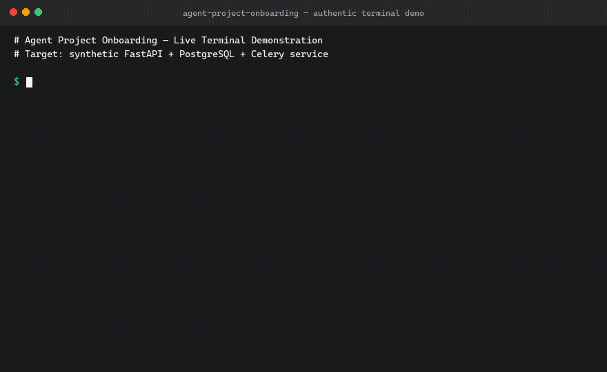

<div align="center">

# Agent Project Onboarding

**Give every new AI coding agent the project context it actually needs.**

[](https://github.com/egecagintepe/agent-project-onboarding/actions)
[](https://github.com/egecagintepe/agent-project-onboarding/releases/latest)
[](https://skills.sh/egecagintepe/agent-project-onboarding)
[](LICENSE)
[](https://www.python.org/downloads/)
[](https://agentskills.io/specification)

*Multi-agent coordination framework and repository handoff protocol. Scans codebases, scaffolds evidence-based 8-dossier contracts (AGENTS.md), and preserves production incident memory across AI agent sessions.*

<br />

```bash
npx skills add egecagintepe/agent-project-onboarding
```

<br />



</div>

---

## Problem → Solution → Result

- **The Problem**: When a developer delegates a task to an AI coding agent (Claude Code, Cursor, Codex, Gemini, Antigravity) in a non-trivial repository:
  1. **Context Saturation**: Dumping 5,000+ lines of documentation into an agent's initial prompt burns token budgets and dilutes attention, causing hallucinations.
  2. **Boundary Violations**: Without strict invariants, agents rewrite database schemas destructively, edit out-of-scope files, or bypass local test harnesses.
  3. **Repeated Regressions**: New agent sessions repeatedly reintroduce bugs that were already diagnosed, suffered, and fixed by the team weeks earlier.
  4. **Fabricated Health**: Naive templates falsely report "All systems verified" based on synthetic mocks without checking live code.

- **The Solution**: `agent-project-onboarding` provides an automated, zero-dependency CLI that scans codebases, gathers concrete file evidence, and scaffolds an 8-dossier progressive disclosure framework anchored by `AGENTS.md`.

- **The Result**: Agents load fewer than 60 lines of constitutional invariants upfront, consult specialized runbooks only when a task touches that subsystem, follow standardized task briefs, and record lessons in an incident ledger ("Happened Once, Never Again").

---

## Quick Install (30 Seconds)

### Option 1: Using Agent Skills CLI (`skills.sh`)
```bash
npx skills add egecagintepe/agent-project-onboarding
```

### Option 2: Direct Agent Integration (Claude Code, Cursor, Codex)
Clone directly into your project's agent skills directory:
```bash
git clone https://github.com/egecagintepe/agent-project-onboarding.git .agents/skills/agent-project-onboarding
```

### Option 3: Standalone CLI Toolkit (Zero Dependencies)
```bash
git clone https://github.com/egecagintepe/agent-project-onboarding.git
cd agent-project-onboarding
python scripts/onboard_project.py --help
```

---

## Live Demo & Synthetic Project

See the reproducible step-by-step walkthrough in [examples/demo_walkthrough.md](examples/demo_walkthrough.md) running against the included synthetic microservice in [examples/synthetic_shop_api/](examples/synthetic_shop_api/).

```
examples/synthetic_shop_api/
├── Dockerfile           # Discovered container manifest
├── main.py              # Discovered FastAPI routing
├── models.py            # Persistence models
├── requirements.txt     # PostgreSQL, Redis, Celery, pytest
├── tasks.py             # Discovered Celery worker tasks
└── tests/test_main.py   # Discovered test runner
```

| Step | Action | Authentic Command |
|---|---|---|
| **1. Scan** | Detect stack & evidence | `python scripts/onboard_project.py scan --path examples/synthetic_shop_api` |
| **2. Preview** | Safe dry-run check | `python scripts/onboard_project.py generate --path examples/synthetic_shop_api --dry-run` |
| **3. Scaffold** | Generate 8 dossiers | `python scripts/onboard_project.py generate --path examples/synthetic_shop_api` |
| **4. Audit** | Verify links & secrets | `python scripts/onboard_project.py audit-dossier --path examples/synthetic_shop_api` |
| **5. Protect** | Re-run without overwriting | `python scripts/onboard_project.py generate --path examples/synthetic_shop_api` (skips existing) |

---

## The 8-Dossier Architecture

`agent-project-onboarding` establishes a standardized, progressive-disclosure documentation package in any repository:

```
[ REPOSITORY ROOT ]
       │
       ├── AGENTS.md (Level 1: Universal Constitutional Contract ~ 60 lines)
       │
       └── docs/
            ├── ARCHITECTURE_MAP.md   (Level 2: System Wiring & Service Boundaries)
            ├── CURRENT_STATE.md      (Level 2: Honest Ledger: DETECTED vs VERIFIED)
            ├── MASTER_BACKLOG.md     (Level 2: Prioritized Single Source of Truth)
            ├── AGENT_ROUTING.md      (Level 3: Task Assignment by Risk Profile)
            ├── PRODUCTION_RUNBOOK.md (Level 3: Deploy & Verification Commands)
            ├── INCIDENT_RUNBOOK.md   (Level 3: "Happened Once, Never Again" Ledger)
            └── BUILD_DEPLOY_MATRIX.md(Level 3: Change-to-Action Impact Matrix)
```

| # | Dossier | File Path | Purpose |
|---|---|---|---|
| **1** | **Agent Contract** | `AGENTS.md` | Core universal contract: permanent workspace, forbidden operations, test policy, token efficiency. |
| **2** | **Architecture Map** | `docs/ARCHITECTURE_MAP.md` | Discovered system components, top-level layout, and service boundaries. |
| **3** | **Current State** | `docs/CURRENT_STATE.md` | Honest audit of feature readiness, known broken modules, and active feature flags. |
| **4** | **Master Backlog** | `docs/MASTER_BACKLOG.md` | Prioritized single source of truth for work items (P0 to P3), acceptance criteria, and owners. |
| **5** | **Agent Routing Guide** | `docs/AGENT_ROUTING.md` | Decision matrix mapping task categories to agent models or human operators. |
| **6** | **Production Runbook** | `docs/PRODUCTION_RUNBOOK.md` | Step-by-step deploy, rollback, and verification commands. |
| **7** | **Incident Ledger** | `docs/INCIDENT_RUNBOOK.md` | "Happened Once, Never Again" post-mortems and symptom-to-remedy runbooks. |
| **8** | **Build & Deploy Matrix**| `docs/BUILD_DEPLOY_MATRIX.md` | "If I modify file X, what must I build, test, migrate, or restart?" |

---

## Evidence-Based Status (No Fabricated Health)

Generated documentation strictly distinguishes verified facts from unverified static assumptions:

- `DETECTED`: Files or configurations exist in repository, but live behavior is unverified.
- `VERIFIED`: Confirmed operational via automated test execution or live smoke checks.
- `UNVERIFIED`: Detected in source code but currently lacking passing verification evidence.
- `UNKNOWN`: Cannot be determined from static repository inspection.
- `NOT_APPLICABLE`: Explicitly excluded or not part of this service.

Every unverified component is paired with an actionable `[TODO: VERIFY]` task.

---

## CLI Usage (`onboard_project.py`)

### 1. Scan Repository Architecture
Recursively inspects codebases to detect languages, frameworks, databases, and existing dossier coverage with concrete evidence:

```bash
python scripts/onboard_project.py scan --path /path/to/project
```

### 2. Scaffold Onboarding Dossiers
Generate the complete 8-dossier scaffolding tailored to the detected stack. Non-destructive by default:

```bash
# Preview generation safely without writing files:
python scripts/onboard_project.py generate --path /path/to/project --project-name "Core Backend" --dry-run

# Execute scaffolding:
python scripts/onboard_project.py generate --path /path/to/project --project-name "Core Backend"
```

### 3. Audit Onboarding Integrity
Verifies all 8 dossiers exist, validates relative markdown links, and checks for accidental secret leakage:

```bash
python scripts/onboard_project.py audit-dossier --path /path/to/project
```

Output:
```text
=== Dossier Audit: PASS ===
All 8 dossiers exist, links resolve, and no secrets detected.
```

---

## Standard Task Brief Template

Assign tasks to AI agents with zero ambiguity using the standardized brief:

````markdown
## Task: <TITLE>

**Context**: docs/CURRENT_STATE.md §<section>
**Priority**: P0 / P1 / P2

**Problem**: <Exact symptom, bug description, or requested capability>
**Acceptance Criteria**:
- <Measurable condition 1>
- <Measurable condition 2>

**Touched Files**:
- path/to/file_a.py
- tests/test_file_a.py

**Inviolable Constraints**:
- Do not modify files outside the touched list.
- Do not introduce fake or stub data to make tests pass.
- Preserve existing comment headers and docstrings.

**Verification Command**:
```bash
python -m unittest tests/test_file_a.py
```
````

---

## Frequently Asked Questions (FAQ)

### Will running `generate` overwrite my existing documentation?
**No.** By default, `generate` is non-destructive. If `AGENTS.md` or any file in `docs/` already exists, the CLI skips it with a warning. You must pass `--force` explicitly to overwrite existing files.

### Does this tool send any telemetry or require network access?
**No.** `onboard_project.py` is written entirely with the Python standard library. It makes zero outbound network requests and stores no external data.

### How does the tool protect against path traversal and symlink attacks?
Target paths are validated using `os.path.commonpath([base, target]) == base`. Sibling directory prefix collisions (e.g. `/path/repo-evil` when the project is `/path/repo`), parent traversal (`../`), and symlink escapes pointing outside the project root are rejected with a `PermissionError`.

### Which AI coding agents support this protocol?
The 8-dossier structure adheres to the open [Agent Skills Specification](https://agentskills.io/specification). It works out of the box with Claude Code, Cursor, Codex, Gemini CLI, Antigravity, and any agent capable of reading `AGENTS.md` and `SKILL.md`.

---

## Deep Documentation

- [Agent Contract Specification (`AGENTS.md`)](references/agent_contract_standard.md) — Constitutional rules
- [Progressive Disclosure Strategy](references/progressive_disclosure_strategy.md) — Token efficiency architecture
- [Model Routing Decision Matrix](references/agent_routing_matrix.md) — Matching task risk to agent strengths
- [Incident Ledger Methodology](references/incident_ledger_standard.md) — Post-mortem ledger standard
- [Standard Task Brief Format](references/task_brief_standard.md) — Bounded prompt handoff specification
- [Sample Task Briefs](examples/task_brief_examples.md) — Real-world prompt examples
- [Reproducible Walkthrough](examples/demo_walkthrough.md) — Synthetic shop API case study

---

## Verified Compatibility

| Environment | Supported | Notes |
|---|---|---|
| **Python** | 3.8, 3.9, 3.10, 3.11, 3.12 | Standard library only; zero external dependencies. |
| **Platforms** | Linux, macOS, Windows | Path traversal protection & cross-platform paths. |
| **Agent Skills** | Specification v1.0 | Validated with official `skills-ref validate`. |
| **AI Agents** | Claude Code, Cursor, Codex, Antigravity | Indexed via `SKILL.md` and root `AGENTS.md`. |

---

## Testing

Run the full automated test suite (24 tests):
```bash
python -m unittest discover -s tests
```

---

## License

This project is licensed under the [MIT License](LICENSE).
